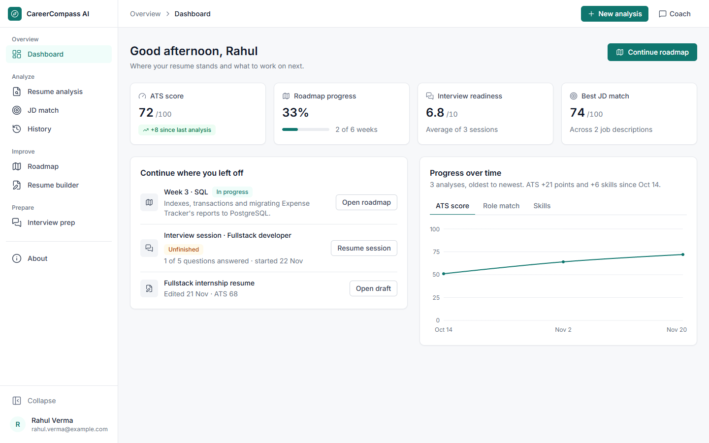
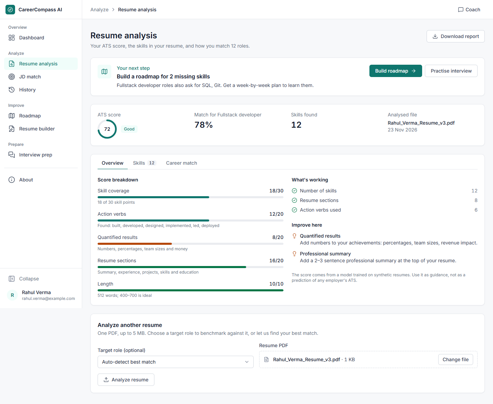
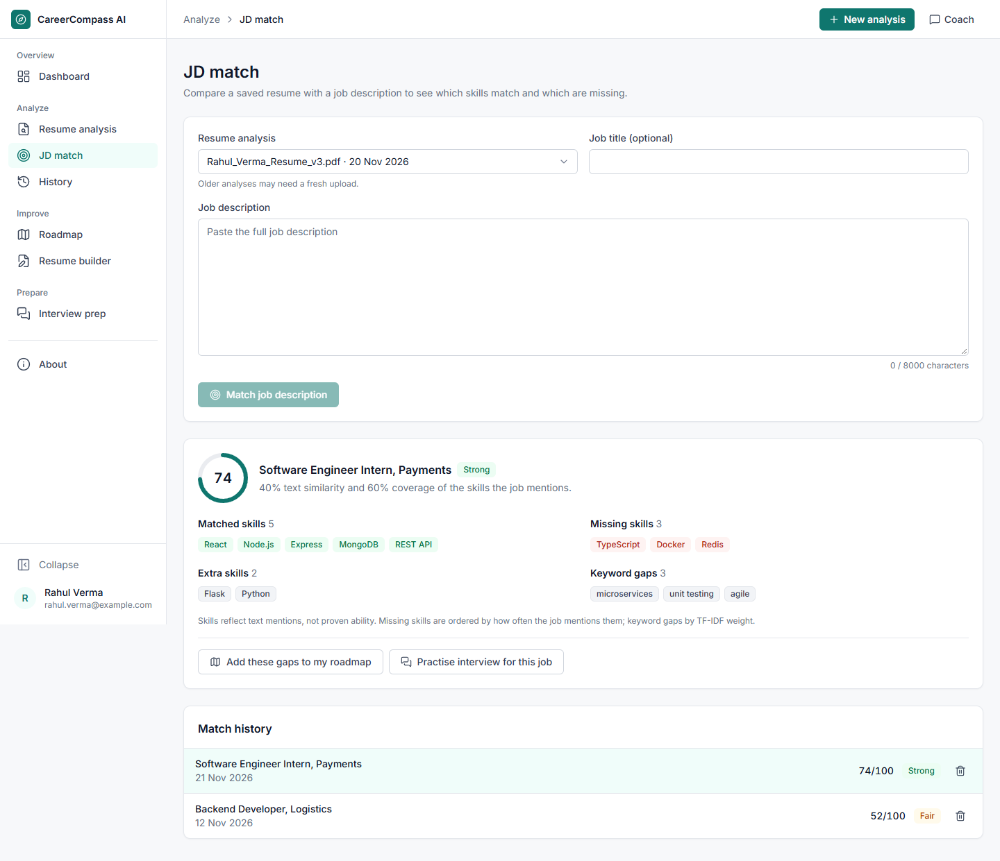
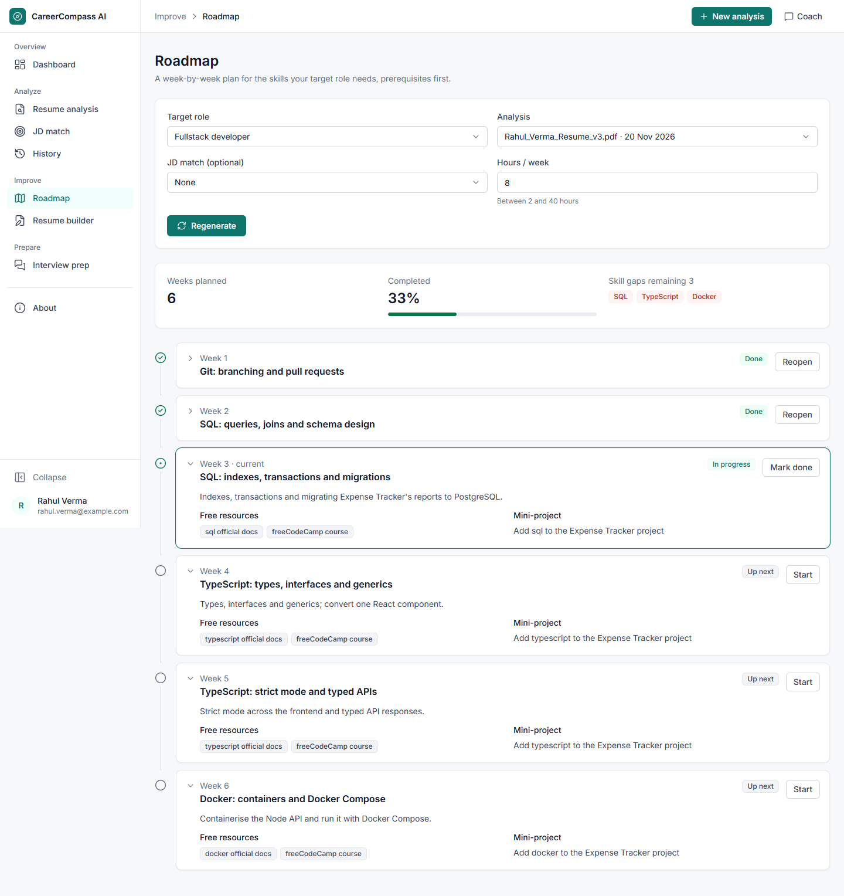
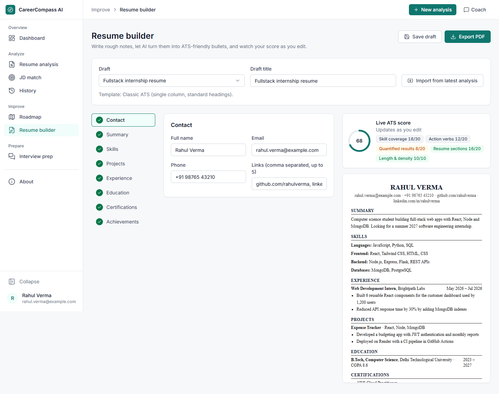
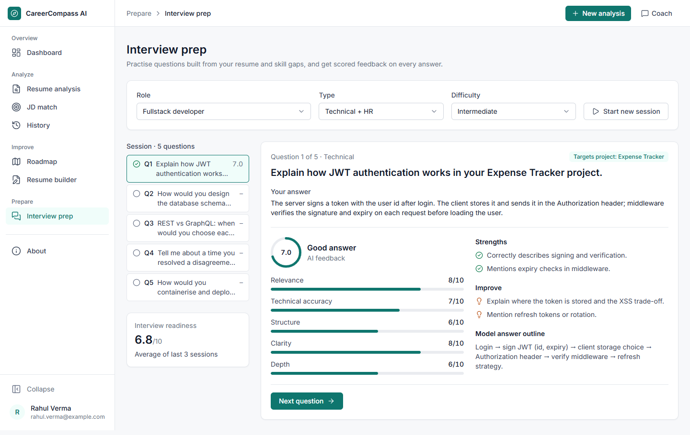

# 🧭 CareerCompass AI

> Resume analysis, deterministic job-description matching and skill gaps, ML-based ATS scoring, and Gemini career guidance.

[](LICENSE)
[](https://nodejs.org)
[](https://react.dev)
[](https://python.org)
[](https://scikit-learn.org)
[](https://mongodb.com/atlas)


---

## 📌 Overview

CareerCompass AI is a full-stack career intelligence platform that analyzes resumes and provides actionable feedback for job seekers.

It uses spaCy and TF-IDF to extract skills, a **GradientBoostingRegressor** to estimate ATS readiness, and Google Gemini for career chat. JD matching compares saved resume text with a pasted job description using TF-IDF similarity and skill coverage, without an LLM.

The ATS model trains on 600 synthetic feature samples across three quality tiers. Its score is a heuristic, not a validated prediction of employer ATS decisions. Matching against 12 predefined career profiles and matching against a custom JD are separate features. Chat resends the current conversation and resume context; it does not persist conversations to MongoDB.

---

## ▶️ Live Demo

[Open CareerCompass AI](https://career-compass-ai-omega-smoky.vercel.app/)

---

## ✨ Features

### 🔐 Authentication
- **Google OAuth 2.0** via Passport.js — one-click sign in, no password required
- JWT-based session management with 7-day token expiry
- Token handoff via redirect after OAuth callback; the client stores the JWT in localStorage

### 📄 Resume Analysis
- Drag & drop PDF upload
- NLP skill extraction using spaCy (lemmatization + two-pass smart matching)
- 200+ skill dictionary with alias normalisation (Node.js → node, sklearn → scikit-learn)
- TF-IDF cosine similarity skill ranking
- Career role matching across **12 job profiles** with match % and missing skills
- Target role selection — benchmarks analysis specifically against your goal role

### 📊 ML-Powered ATS Scoring
- **GradientBoostingRegressor** trained on 600 synthetic resume samples
- Scores resumes across **10 features**: skill count, skill density, action verb count, verb density, quantified achievements, section count, word count, sentence length, contact info, summary presence
- Feature importance extraction — surfaces **top_drivers** (what scored well) and **improve_here** (what to fix)
- Actionable ML-powered improvement tips per feature
- Score out of 100 with circular gauge UI

### 🎯 JD Matching & Skill Gaps
- Choose a saved resume analysis and paste a job description of up to 8000 characters
- Deterministic score: 40% TF-IDF cosine similarity + 60% detected JD skill coverage
- Matched, missing, and extra skill chips; top keyword gaps; Weak / Fair / Strong verdict
- Saved match history with owner-only access and deletion
- Older analyses without saved resume text require a fresh upload

### 🗺️ Career Roadmap
- Week-by-week learning plan (up to 6 weeks, at most 2 weeks per skill gap, 2–40 hours per week) for one of the 12 target roles, each week titled with a specific subtopic
- Gaps = the role's missing skills from a saved analysis, plus missing skills from an optional saved JD match, minus skills already on the resume
- Prerequisites come first (e.g. JavaScript → TypeScript, Docker → Kubernetes, Python → pandas → scikit-learn)
- Each week has an objective, 2–3 free resources, and a mini-project that extends a project from your resume when one is found
- Track status per milestone (Upcoming → In progress → Completed); uploading a new resume that shows a skill marks its milestones complete

### 📝 AI Resume Builder
- Section-by-section editor (contact, summary, skills, projects, experience, education, certifications, achievements) with completion ticks
- Write rough notes and **Enhance with AI** to get 2–4 action-verb bullets; Accept, Edit, Regenerate, or Discard
- Guardrail: a suggestion containing any number that is not in your notes or title is rejected and regenerated once
- Live ATS score (same ML model as resume analysis) recalculated about 800 ms after you stop editing
- Single-column, serif, ATS-friendly preview; import grouped skills and summary from your latest analysis
- Save up to 20 drafts and export an A4 PDF with selectable text

### 🎤 Interview Prep with AI Feedback
- Sessions of 5 questions for one of the 12 target roles: Technical, HR, Behavioural, or Technical + HR; Beginner to Advanced
- Questions are built from your latest analysis: at least one targets a skill gap and at least one targets a project from your resume
- Type an answer or use **Answer by voice** (browser speech-to-text, shown only where the browser supports it)
- Feedback per answer: 1–10 scores for relevance, technical accuracy, structure (STAR for HR/behavioural), clarity and depth; strengths, improvements and a model answer outline
- Interview readiness: average score of your last 5 sessions and the change versus the 5 before

### 💬 AI Career Chatbot
- Google Gemini powered career advisor
- Full validated conversation history and resume ML insights retained per request
- Server-owned system prompt; clients send only message and history
- Discuss resume details and target roles through conversation text
- Also knows your latest roadmap's next milestone and your last interview score (from the dashboard summary)

### 📄 PDF Report Export
- Download full ATS analysis report as PDF (jsPDF + html2canvas)
- Frontend-based rendering — no backend load

### 🔀 Resume Comparison
- Select any 2 past analyses and compare side-by-side
- Compare ATS scores, role matches, and gained/lost/common skills

### 📊 Progress Tracker & Dashboard
- Skills progress tracker across multiple analyses over time
- Dashboard stats: total analyses, top matched role, average and latest ATS score, last analysis date, JD-match count, best JD-match score, roadmap completion with the next milestone, and interview readiness, all from one `GET /api/dashboard/summary` request
- Quick-action cards for Career Roadmap, AI Resume Builder and Interview Prep
- Visual progress bars and glassmorphism UI

### 🔗 Connected Workflow
- ATS report → **Build my roadmap** / **Practise interview**, with this analysis and its target (or best-matched) role pre-selected
- JD Match result → **Add these gaps to my roadmap** (pre-selects the match, so regenerating adds the job's missing skills) and **Practise interview for this job** (the session's gaps start with the job's missing skills)
- Resume Builder → **Analyze this resume** after export hands the exported PDF straight to Analyze
- Cross-links only pre-select; generating a roadmap or starting a session is always your click

### 🕓 Analysis History
- Every analysis saved to MongoDB with full mlInsights
- View, manage, and delete past reports

---

## 🏗️ Architecture

CareerCompass AI is a distributed 3-service architecture:

```
┌─────────────────────────────────────────────────────────────────┐
│                        User Browser                             │
│                    React 19 + Tailwind CSS                      │
│                      (Vercel — CDN)                             │
└──────────────────────────┬──────────────────────────────────────┘
                           │ HTTPS / JWT
                           ▼
┌─────────────────────────────────────────────────────────────────┐
│                    Node.js / Express                            │
│         Auth · Upload · History · JD Match Routes               │
│                    (Render — Web Service)                       │
│                           │                                     │
│              ┌────────────┴────────────┐                        │
│              ▼                         ▼                        │
│     MongoDB Atlas                 Flask ML Service              │
│ (Users · Analyses · JDMatches)     spaCy · TF-IDF · GBR          │
│                               Google Gemini                     │
│                           (Hugging Face Spaces)                 │
└─────────────────────────────────────────────────────────────────┘
```

| Service | Technology | Host |
|---|---|---|
| Frontend | React 19 + Tailwind CSS | Vercel |
| Core Backend | Node.js + Express.js | Render |
| ML / NLP Engine | Python + Flask + scikit-learn | Hugging Face Spaces |
| Database | MongoDB Atlas | MongoDB Cloud |

---

## 🔁 Request Flow

```
User uploads Resume PDF
        ↓
React → POST /upload (JWT protected, multipart/form-data)
        ↓
Node.js validates JWT → saves PDF via Multer → forwards to Flask
        ↓
Flask: pdfminer extracts raw text
        ↓
normalize() → alias replacement (Node.js → node, etc.)
        ↓
extract_skills() → regex pass + spaCy lemmatization (2-pass)
        ↓
rank_skills_tfidf() → cosine similarity ranking
        ↓
extract_features() → 10 numeric features from resume text
        ↓
GradientBoostingRegressor.predict() → ATS score (0-100)
        ↓
get_feature_importances() → top_drivers + improve_here
        ↓
match_roles() → 12 role scores + missing skills
        ↓
Flask returns JSON → Node.js saves analysis, mlInsights, and bounded resume text
        ↓
React renders: ATS Report + ML Insights + Career Match + Chatbot
```

JD matching: React sends `analysisId`, `jd_text`, and optional `jdTitle` to Node.
Node validates the JWT, rate limit, payload, and analysis ownership, then sends the saved resume text
and JD to Flask with `X-Internal-Key`. Flask returns deterministic results; Node saves a `JDMatch`
record and returns it to the page. Resume text is excluded from normal analysis-history responses.

Career roadmap: React sends `analysisId`, `hoursPerWeek`, and optional `targetRole` / `jdMatchId` to Node.
Node checks ownership of the analysis (and JD match), then sends the role's missing skills, JD missing skills,
known resume skills, and saved resume text to Flask `/roadmap`. Flask orders the gaps, asks Gemini (through
`llm.py`, JSON mode) for the milestones, validates them, and returns them; Node validates again, saves a
`CareerRoadmap`, and returns it.

Resume builder: React sends notes to Node `/api/resume-builder/enhance`; Node validates and forwards
`{ section, title, notes, tone }` to Flask `/resume/enhance`, which calls Gemini through `llm.py` and checks the
bullets before returning them. As you edit, React sends the resume's plain text to `/api/resume-builder/score`;
Flask scores it with the same `extract_skills` + `compute_ats_score_ml` pipeline as `/analyze`. Drafts are stored
in MongoDB (`ResumeDraft`) only when you click Save draft.

Interview prep: React sends `{ role, type, difficulty }` to Node `/api/interview/start`. Node loads your latest
analysis (or the `analysisId` you send, if it is yours), and sends its skills, the role's missing skills and the
project titles found in the resume's Projects section to Flask `/interview/questions`, which asks Gemini (through
`llm.py`, JSON mode) for 5 questions and validates them. Node saves an `InterviewSession`. Each answer goes to
`/api/interview/:id/answer`; Node forwards the question, type, role and answer to Flask `/interview/evaluate`,
recomputes the overall score from the five rubric scores, and stores the feedback on that question.

---

## 🧾 API Reference

### Node API (`server/`, called by the browser)

Every route except `/` and the OAuth routes requires `Authorization: Bearer <JWT>` and returns JSON 401
without it. Records are scoped to the caller: another user's ID returns the same 404 as a missing one, and a
malformed ID returns 400 (except the older `DELETE /api/history/:id`). All `/api/*` routes also share a
300 requests / 15 min per-IP limit. "Per user" limits are per 15 minutes.

| Method | Path | Body / notes | Per-user limit |
|---|---|---|---|
| GET | `/` | Health text (public) | – |
| GET | `/api/auth/google`, `/api/auth/google/callback` | Google OAuth; redirects to `CLIENT_URL?token=…` (public) | – |
| GET | `/api/auth/me` | Current user (verifies the token itself) | – |
| POST | `/upload` | multipart `resume` (one PDF, ≤5 MiB), optional `targetRole` ≤100 | none (known gap) |
| GET | `/api/history` | Your analyses (without resume text) | – |
| DELETE | `/api/history/:id` | Delete one analysis | – |
| POST | `/api/jd-match` | `{ analysisId, jd_text ≤8000, jdTitle? ≤120 }` → 201 | 20 |
| GET | `/api/jd-match/history` | Your JD matches | – |
| DELETE | `/api/jd-match/:id` | Delete one JD match | – |
| POST | `/api/agent/chat` | `{ message ≤2000, history: [{ role, content }] }` → `{ reply }` | 20 |
| POST | `/api/roadmap` | `{ analysisId, hoursPerWeek 2–40, targetRole?, jdMatchId? }` → 201 | 10 |
| GET | `/api/roadmap` | Your latest roadmap or `null` | – |
| GET | `/api/roadmap/:id` | One roadmap | – |
| PATCH | `/api/roadmap/:id/milestone/:mid` | `{ status: todo\|progress\|done }` | – |
| GET / POST | `/api/resume-builder/drafts` | List drafts / create one (201, max 20 per user, then 409) | – |
| GET / PUT / DELETE | `/api/resume-builder/drafts/:id` | Read, replace, or delete one draft | – |
| POST | `/api/resume-builder/enhance` | `{ section, title ≤120, notes ≤1500, tone }` → `{ bullets }` | 30 |
| POST | `/api/resume-builder/score` | `{ text ≤50000 }` → `{ atsScore, atsBreakdown, mlInsights }` | 120 |
| POST | `/api/resume-builder/import` | `{ analysisId }` → `{ sections, summarySource, resumeName }` | – |
| POST | `/api/interview/start` | `{ role, type, difficulty, analysisId?, jdMatchId? }` → 201 session | 10 |
| POST | `/api/interview/:id/answer` | `{ qid, answer ≤4000 }` → updated session (409 if already answered) | 40 |
| GET | `/api/interview/history` | Latest 50 sessions, without questions' text, answers or feedback | – |
| GET | `/api/interview/:id` | One session with answers and feedback | – |
| GET | `/api/dashboard/summary` | All dashboard numbers in one response (see below) | – |
| GET | `/api/ml/health` | Proxies Flask `/health` | – |

`GET /api/dashboard/summary` returns:
`{ analyses: { count, averageAts, latestAts, topRole, latestAnalysisId, latestAnalysisAt },
jdMatches: { count, best }, roadmap: { id, targetRole, covered, total, done, completion, nextMilestone } | null,
interview: { readiness, sessions, change, lastScore } | null }`.
`completion` is the percentage of the latest roadmap's milestones marked done (100 for a covered roadmap).
`nextMilestone` is the earliest week not yet done. `readiness` is the mean score of your latest 5 scored
sessions, and `change` is the difference from the 5 before.

### Flask ML service (`ml-service/`, called only by Node)

Every route except `/health` requires `X-Internal-Key: <INTERNAL_API_KEY>`. A wrong or missing key returns
401, and an unset key on the server returns 403. Requests are capped at 5 MiB. Routes that use Gemini return
503 with a safe message when the quota is exhausted or the provider is unavailable, and 502 when the model's
output fails validation after one retry.

| Method | Path | Body → response | Uses Gemini |
|---|---|---|---|
| GET | `/health` | → `{ status, gemini, model, model_ready }` (public) | no |
| POST | `/analyze` | multipart `resume`, `targetRole?` → skills, role matches, ATS score, `raw_text` | no |
| POST | `/jd-match` | `{ resume_text, jd_text }` → overall match, verdict, skill lists | no |
| POST | `/agent/gap` | `{ message, history }` → `{ reply }` | yes (text) |
| POST | `/roadmap` | `{ target_role, missing_skills, jd_gaps, known_skills, hours_per_week, weeks?, resume_text? }` → milestones | yes (JSON) |
| POST | `/resume/enhance` | `{ section, title, notes, tone }` → `{ bullets }` | yes (JSON) |
| POST | `/resume/score` | `{ text }` → `{ ats_score, ats_breakdown, ml_insights }` | no |
| POST | `/interview/questions` | `{ role, type, difficulty, resume_skills, gaps, projects, count 3–10 }` → `{ questions }` | yes (JSON) |
| POST | `/interview/evaluate` | `{ question, type, role, answer ≤4000 }` → scores, overall, feedback | yes (JSON), skipped for answers under 15 words |
| POST | `/retrain` | no body → retrains the ATS model | no |

---

## 🔐 Authentication Flow

```
User clicks "Continue with Google"
        ↓
Frontend → GET /api/auth/google
        ↓
Passport.js redirects to Google consent screen
        ↓
Google → GET /api/auth/google/callback
        ↓
Passport verifies profile → upserts User in MongoDB
        ↓
Server generates JWT → redirects to CLIENT_URL?token=...
        ↓
React reads token from URL (synchronous useState initializer)
        ↓
OAuthSuccess: saves token to localStorage → fetches /api/auth/me
        ↓
AuthContext sets user state → navigate to Dashboard
```

---

## 🧠 ML Model Details

The ATS scoring engine uses a **scikit-learn Pipeline**:

```
StandardScaler → GradientBoostingRegressor
  n_estimators=200 | learning_rate=0.05 | max_depth=4
```

**Training data:** 600 synthetic resume samples across 3 quality tiers (poor / average / good) with Gaussian noise (σ=3) for smooth score distribution. Seed fixed at 42 for reproducibility.

**Feature importances** come from `regressor.feature_importances_`. These are global model importances,
not per-resume causal explanations. `top_drivers` pairs them with resume measurements; `improve_here`
uses additional rules to suggest improvements.

**Model persistence:** Saved as `ats_model.pkl` on first startup. Reloaded on subsequent restarts. Retrainable only through Flask `POST /retrain` with the internal API key.

---

## 🛠️ Tech Stack

| Layer | Technology |
|---|---|
| Frontend | React 19, Tailwind CSS, Axios, jsPDF, html2canvas |
| State Management | React Context API (AuthContext) |
| Backend | Node.js ≥20.19.0 (Mongoose 9 requirement), Express 5 |
| File Handling | Multer (PDF uploads) |
| Authentication | Google OAuth 2.0, Passport.js, JWT, bcryptjs |
| Database | MongoDB Atlas, Mongoose |
| NLP | Python, spaCy (en_core_web_sm), TF-IDF, pdfminer.six |
| ML Model | scikit-learn (GradientBoostingRegressor, StandardScaler, Pipeline) |
| AI Chatbot | Google Gemini |
| Deployment | Vercel (frontend), Render (backend), Hugging Face Spaces (ML) |

---

## 📂 Project Structure

```
CareerCompass-AI/
├── client/                         # React frontend
│   ├── src/
│   │   ├── components/             # Navbar, ATSReport, CareerAgent, ProgressTracker
│   │   ├── context/                # AuthContext (JWT session management)
│   │   ├── constants/              # targetRoles (the 12 roles shared by Analyze and Roadmap)
│   │   ├── utils/                  # resumeDraft (draft shape, plain text), resumePdf (A4 export)
│   │   ├── pages/                  # AuthPage, OAuthSuccess, UploadResume, History, Dashboard,
│   │   │                           # JDMatch, Roadmap, ResumeBuilder, InterviewPrep, About, Compare, Profile
│   │   └── App.js
├── server/                         # Node.js backend
│   ├── config/                     # passport.js (Google OAuth strategy)
│   ├── middleware/                 # JWT auth middleware
│   ├── lib/                        # resumeBuilder.js (draft limits/validation, skill grouping),
│   │                               # interview.js (limits, project titles, feedback validation)
│   ├── models/                     # User, Analysis (+ resumeText), JDMatch, CareerRoadmap, ResumeDraft,
│   │                               # InterviewSession
│   ├── routes/                     # auth.js (Google OAuth, /me)
│   ├── server.js
│   └── .env
└── ml-service/                     # Python ML + NLP service
    ├── app.py                      # Flask, spaCy, TF-IDF, GBR, Gemini
    ├── llm.py                      # Swappable text-generation provider
    ├── roadmap.py                  # Gap ordering + roadmap response validation
    ├── resume_builder.py           # Notes → bullets prompt + number-hallucination guard
    ├── interview.py                # Question generation + rubric feedback validation
    ├── requirements.txt
    └── .env
```

---

## 🎯 JD Matching: Scoring and Limits

Open **JD Match**, choose a saved analysis, and paste up to 8000 Unicode characters of job description.
New uploads retain up to 50,000 characters of extracted resume text, excluded from history responses.
Older analyses without saved text require re-upload; skills alone cannot reconstruct a resume.

The deterministic score is `100 × (0.40 × TF-IDF cosine similarity + 0.60 × skill coverage)`.
TF-IDF is fitted to the normalized resume/JD pair using unigrams, English stop-word removal, and
scikit-learn's default tokenization and IDF smoothing. Coverage is matched distinct JD skills divided
by all detected distinct JD skills. The existing normalizer and skill extractor handle aliases in both texts.
If no JD skills are detected, coverage is zero; weights are not redistributed. Empty vocabularies have
zero text similarity. Scores are rounded to one decimal: **Weak <50**, **Fair 50–<75**, **Strong ≥75**.
The 60% skill weight favors explicit requirements over similar wording (40%).

Matched/missing skills sort by normalized JD mention count descending, then alphabetically; extra
resume skills sort alphabetically. Keyword gaps are the top ten JD TF-IDF terms absent from the resume,
with alphabetical ties. No LLM or ATS regression model participates in this score.

Limits: vocabulary coverage, alias rules, PDF extraction, and truncation affect results. The existing
extractor can produce false positives; mentions and frequency do not establish proficiency, required
versus optional skills, negation, experience level, or hiring likelihood. Tokenization can lose punctuation
in terms such as C++. Keyword gaps are wording suggestions, not instructions to invent experience.

`POST /api/jd-match` accepts `{ analysisId, jd_text, jdTitle? }` (title at most 120 characters).
JWT authentication and analysis ownership are required; POST is limited to 20 requests/user/15 minutes.
`GET /api/jd-match/history` and `DELETE /api/jd-match/:id` are owner scoped. Missing/foreign IDs return
the same 404; malformed inputs return 400, overlength JDs 413, throttling 429, and unavailable ML 503.
Records retain the JD (bounded to 8000 characters), result, title, analysis reference, and creation time.
Deleting an analysis leaves its saved JD matches available until separately deleted.

The internal Flask endpoint `POST /jd-match` accepts `{ resume_text, jd_text }` with nonblank strings,
at most 50,000 resume characters and 8000 JD characters. Its result contains `overall_match`,
`matched_skills`, `missing_skills`, `extra_skills`, `keyword_gaps`, and `verdict`.
Node returns HTTP 201 with the saved record, including that result under `result`. Missing/invalid
JWTs return 401; database failures return sanitized 500 errors. Call Flask through Node in the browser.

## 🗺️ Career Roadmap: Rules and Limits

Open **Roadmap**, choose a target role, a saved analysis, an optional saved JD match, and hours per week
(2–40), then **Generate**. If you don't choose a role, the analysis's target role (or best-matching role) is used.

Gap list: the analysis's missing skills for the role come first, then the JD match's missing skills.
Skills already detected on the resume are removed and duplicates are dropped. A small prerequisite map in
`ml-service/roadmap.py` then sorts the gaps so (transitive) prerequisites come first. Unrelated skills keep their order.
If no gaps remain, the result says you already cover the role and Gemini is not called.

The plan has `min(weeks, 2 × gaps)` weeks (`weeks` defaults to 6), so a single gap gives a 2-week plan.
Gemini is asked for exactly that many milestones of `{ week, skill, title, objective, resources, mini_project }`:
- each skill must come from the gap list
- `title` names a specific subtopic, such as "REST API: routing and status codes"
- resources must be 2–3 free resources

The prompt includes up to 1500 characters of the resume's Projects section, so mini-projects can extend
existing work.

Flask checks every field: required keys, types and lengths; weeks 1..N, each once; skills from the gap list.
It also rejects:
- a title that is only the skill name
- more than 2 weeks on one skill
- any title used more than twice

It then reorders milestones by gap order. Node repeats these checks before saving.

A schema-invalid response is retried once; after that, Flask returns 502
`AI returned an invalid roadmap. Try again.` Malformed JSON is repaired once inside `llm.py`. One generation can
therefore make up to six SDK requests in the worst case. If there are more gaps than weeks, only the first
`weeks` gaps fit, and the rest stay listed as remaining gaps. A role you already cover shows "You cover this role.
Pick another role or add a JD match." instead of a plan.

Milestones are LLM suggestions: check that each resource exists and is still free. A milestone is marked
complete automatically only when a later upload's extracted skills include it, which is a text mention, not proof of ability.

API (all JWT-protected and owner-scoped; another user's records return 404, malformed IDs 400):
- `POST /api/roadmap` `{ analysisId, hoursPerWeek, targetRole?, jdMatchId? }` returns 201 with the saved roadmap.
  `targetRole` must be one of the 12 roles. Unknown fields, bad types, or out-of-range hours return 400.
  It is limited to 10 requests/user/15 minutes (429). Flask failures return 502 (invalid AI roadmap) or 503, with safe messages only.
- `GET /api/roadmap` returns your latest roadmap or `null`. `GET /api/roadmap/:id` returns one roadmap.
- `PATCH /api/roadmap/:id/milestone/:mid` `{ status: "todo" | "progress" | "done" }` returns the updated roadmap.

Internal Flask `POST /roadmap` (requires `X-Internal-Key`) accepts `{ target_role, missing_skills, jd_gaps,
known_skills, hours_per_week, weeks?, resume_text? }`. The limits are: role ≤100 characters; skills ≤60 characters;
at most 50 missing/JD gaps and 300 known skills; integer hours 2–40; integer weeks 4–12; resume ≤50,000 characters.
It returns `{ covered, message, skill_gaps, milestones }`. Roadmaps are saved in MongoDB as `CareerRoadmap`
records (`userId`, `analysisId`, optional `jdMatchId`, `targetRole`, `hoursPerWeek`, `skillGaps`, `covered`,
`milestones` with `status`).
No new environment variables are needed: generation uses the ML service's existing `GEMINI_API_KEY`.

## 📝 AI Resume Builder: Rules and Limits

**Enhance with AI** rewrites your notes for an experience, project, or summary into 2–4 items (bullets that
start with an action verb from the ATS model's `ACTION_VERBS` list, or summary sentences), in a Professional
or Concise tone. The server-owned prompt forbids inventing employers, technologies, metrics, or experience.
Flask then enforces what it can check deterministically:
- 2–4 non-blank strings, each at most 220 characters (leading bullet symbols are stripped)
- **every number in a suggestion must appear in your notes or title** (`2,000` and `2000` count as the same).
  This rejects invented metrics, years, and version numbers (such as `HTML5` when you wrote `html`).
  Inflation that reuses your number (`300+` from `around 300`) passes this check; only the prompt forbids it.

A response that fails these checks is retried once; after that, Flask returns 502 `AI returned an invalid
suggestion. Try again.` (`llm.py` separately repairs malformed JSON once, so one click can make up to four SDK
requests.) Invented technologies or claims without numbers cannot be detected automatically, so read every
suggestion before accepting it.

**Live ATS score** uses the same feature extraction and GradientBoostingRegressor as PDF analysis, on the
builder's plain-text rendering (standard headings, one column), about 800 ms after edits stop. It is the same
heuristic score described above, not a prediction of any employer's ATS.

**Import from latest analysis** fills the Skills section with your latest analysis's detected skills, grouped
(Languages, Frontend, Backend, Databases, Cloud & DevOps, Data & AI, …), and fills an empty Summary with the
resume's own Summary/Objective/Profile section. If the resume has none, it writes a one-line factual summary
from the target role and detected skills. An existing summary is never overwritten.

**Export PDF** draws A4 pages with jsPDF's text API rather than an html2canvas screenshot, so the text stays
selectable and readable by ATS parsers. The built-in Times font covers Latin-1 characters only; symbols such as
₹ or emoji will not render.

API (all JWT-protected; drafts are owner-scoped and another user's drafts return 404; malformed IDs return 400):
- `GET /api/resume-builder/drafts` lists your drafts (title, template, atsScore, timestamps). `POST` creates one
  and returns 201. Each user can keep up to 20 drafts; a 21st returns 409.
- `GET` / `PUT` / `DELETE /api/resume-builder/drafts/:id`. `PUT` replaces the whole draft.
- `POST /api/resume-builder/enhance` `{ section: experience|project|summary, title ≤120, notes ≤1500, tone: professional|concise }`
  returns `{ bullets }`. It is limited to 30 requests/user/15 minutes.
- `POST /api/resume-builder/score` `{ text ≤50000 }` returns `{ atsScore, atsBreakdown, mlInsights }`.
  It is limited to 120 requests/user/15 minutes.
- `POST /api/resume-builder/import` `{ analysisId }` returns `{ sections: { summary, skills }, summarySource, resumeName }`.

Draft bodies are validated strictly: unknown fields or wrong types return 400, and over-limit values return 413.
The limits are: title 120; name 100; email 254; phone 40; up to 5 links of 200; summary 1500; up to 10 skill groups
of 30 skills (60 characters each); up to 10 experience and 10 project entries with up to 8 bullets of 300
characters (projects also take up to 15 tech tags); up to 6 education entries; and up to 20 certifications and
20 achievements of 300 characters. `template` accepts only `classic` (Classic ATS). The internal Flask routes
`POST /resume/enhance` and `POST /resume/score` require `X-Internal-Key` and apply the same input limits.
No new environment variables are needed.

## 🎤 Interview Prep: Rules and Limits

**Questions.** Starting a session sends Flask the role, type, difficulty, up to 300 resume skills, up to 50
skill gaps (the role's missing skills from your analysis, minus skills already on the resume) and up to 5
project titles. Project titles are the non-bullet lines under the resume's Projects heading, cut before any
` - `, ` | `, `: ` or `(` (tech stack, dates). Lines that look like sentences or wrapped bullets are skipped.
Without any analysis, a session still starts with general questions. Flask checks the model's 5 questions:
- each is non-blank and at most 300 characters, of an allowed type for the session, with no duplicates
- question IDs (`q1`–`q5`) are assigned by Flask, not the model
- what each question tests is decided by Flask: a **gap**, **project** or **skill** when the model's target
  names one from the input (exact or whole-word match), otherwise a free **topic**
- at least one question targets a gap and one a project (when you have any), and a Technical + HR session
  contains both technical and HR/behavioural questions

**Feedback.** The model returns five integer scores from 1 to 10, 1–3 strengths, 1–3 improvements (each at
most 300 characters) and a model answer outline of at most 300 characters. For HR and behavioural questions,
*structure* scores the STAR format (Situation, Task, Action, Result). The **overall score is the mean of the five
scores rounded to one decimal place, recomputed by Flask and again by Node**; any overall the model sends is
ignored. An answer under 15 words never reaches the AI: it scores 1 on every criterion with a fixed tip and a
generic outline. A session's score is the mean of its answered questions. The session is marked completed when
all 5 are answered, and an answered question cannot be answered again (409).

Invalid model output is retried once, then Flask returns 502 `AI returned invalid questions. Try again.` or
`AI returned invalid feedback. Try again.` The ATS caveat applies here too: these scores are AI coaching
feedback, not a prediction of any real interview outcome.

**Answer by voice** uses the browser's Web Speech API (Chrome, Edge, Safari) and is hidden where it is not
supported. Speech is transcribed by the browser vendor's service, not by CareerCompass; only the resulting
text is sent when you submit.

API (all JWT-protected and owner-scoped; another user's session returns 404; malformed IDs return 400):
- `POST /api/interview/start` `{ role, type: technical|hr|behavioural|mixed, difficulty: beginner|intermediate|advanced, analysisId?, jdMatchId? }`
  returns the new session (201). It is limited to 10 requests/user/15 minutes. With `jdMatchId` (must be your
  own JD match, otherwise 404), that job's missing skills come first in the gaps, and the match's analysis is
  used unless you pass `analysisId`.
- `POST /api/interview/:id/answer` `{ qid, answer ≤4000 }` returns the updated session. An empty answer is
  allowed and scored as a short answer. It is limited to 40 requests/user/15 minutes.
- `GET /api/interview/history` lists your latest 50 sessions (role, type, difficulty, status, overallScore, and
  per-question qid/overall/answeredAt, with no question text, answers or feedback).
- `GET /api/interview/:id` returns one session with answers and feedback.

The internal Flask routes `POST /interview/questions` and `POST /interview/evaluate` require `X-Internal-Key`
and apply the same input limits. No new environment variables are needed.

### Tests and manual checks

From the repository root, after completing local setup:

```powershell
.\ml-service\venv\Scripts\python.exe -m unittest discover -s ml-service -p "test_*.py"
npm --prefix server test
cd client; $env:CI="true"; npx react-scripts test --watchAll=false; cd ..
npm --prefix client run build
```

On bash use `cd client && CI=true npx react-scripts test --watchAll=false`.

On macOS/Linux, replace the Python executable above with `./ml-service/venv/bin/python`.
Scoring tests use real scikit-learn and stub spaCy's lemma
pass; Node tests use real JWT, middleware, and schema validation with mocked MongoDB and Flask calls.
For an integration check, start all three services and upload a PDF containing
`Python Flask PostgreSQL Docker`. Match the same text (Strong), then
`Figma wireframing prototyping Adobe XD user research` (Weak). Check chips, history, and Dashboard
count/best score. Empty/whitespace JD must return 400; an 8001-character JD must return 413 via API
(both are blocked in the UI). With another account's JWT, submit the first account's analysis ID:
expect 404 and no saved match. Confirm foreign matches cannot be listed or deleted, and deleting an
owned match updates its history and Dashboard stats.

## ⚙️ Environment Variables

**Vercel (Frontend)**
```env
REACT_APP_API_URL=https://your-backend-on-render.com
```

**Render (Backend)**
```env
MONGO_URI=mongodb+srv://...
JWT_SECRET=your_secret_key
GOOGLE_CLIENT_ID=your_google_client_id
GOOGLE_CLIENT_SECRET=your_google_client_secret
GOOGLE_CALLBACK_URL=https://your-backend.onrender.com/api/auth/google/callback
CLIENT_URL=https://your-frontend.vercel.app
ML_SERVICE_URL=https://your-space.hf.space
PORT=5000
INTERNAL_API_KEY=replace_with_shared_random_secret
TRUST_PROXY_HOPS=1
```

**Hugging Face Spaces (ML Service)**
```env
GEMINI_API_KEY=your_gemini_api_key
GEMINI_MODEL=gemini-3.5-flash-lite
INTERNAL_API_KEY=replace_with_shared_random_secret
```

Chat uses Google's official [`google-genai` Python SDK](https://googleapis.github.io/python-genai/).
Create a key in [Google AI Studio](https://aistudio.google.com/apikey) and store `GEMINI_API_KEY`
only in the ML service's environment/Space Secrets. The code defaults `GEMINI_MODEL` to
`gemini-3.5-flash-lite`; configure a model available to your Google project. Provider availability,
quotas, and pricing are external to this repository. No Gemini secret belongs in the browser or Node environment.

All LLM requests pass through `ml-service/llm.py:generate(system_prompt, messages, json_mode=False, max_output_tokens=1024)`.
It maps assistant messages to Gemini's `model` role and uses `system_instruction` for the server prompt.
Resume analysis and ML insights are injected as user context on each turn, including after clearing chat.
Requests time out after 10 seconds per SDK request; transient network/408/429/500/502/503/504 failures retry once
after a one-second backoff. SDK automatic retries are disabled. Exhausted quota returns JSON HTTP 503
with `AI quota exhausted or rate limit reached. Try again later.` Invalid keys/configuration also return a safe 503.
The Node proxy preserves only known safe error messages. JSON mode requests `application/json`, parses the response,
retries malformed JSON once, then raises `LLMError`; successful calls always return a string, including JSON mode.
There is one transient retry and one JSON repair retry per invocation (at most three SDK requests).

Deploy the ML service, then Node, then the client so history handling and safe error messages agree.
The chat request/response shape is `{message, history}` / `{reply}`.

---

Set the **same strong random `INTERNAL_API_KEY`** in Render environment variables and Hugging Face Space **Secrets**.
Use the same value in both local `.env` files. Never place it in Vercel/client configuration or commit it.
Node sends the key on every Flask request. Copy `server/.env.example` and `ml-service/.env.example` for local setup.
`TRUST_PROXY_HOPS` defaults to `0` locally; use `1` only when Render is the single trusted reverse proxy.
Verify the proxy topology before changing it, since it controls the IP used for rate limiting.

Security limits: `/api` permits 300 requests per 15 minutes per IP; authenticated chat permits 20 per user per 15 minutes;
roadmap generation permits 10 per user per 15 minutes; resume-builder AI suggestions permit 30, and live scoring 120,
per user per 15 minutes; interview sessions permit 10 starts and 40 answers per user per 15 minutes.
These counters are in memory per Node process and reset on restart; multiple replicas require a shared store.
Uploads require one PDF, PDF MIME type, `.pdf` extension, and `%PDF-` signature; Node limits file size to 5 MiB.
Flask limits the entire request (including multipart overhead) to 5 MiB and uses at most 50,000 extracted characters.
Chat accepts exactly `{message, history}`: message is nonblank and 1–2000 characters; history is an array
of `{role: "user"|"assistant", content: string}` with nonblank content, up to 2000 characters for user messages
and 16000 for assistant replies. Both services validate and retain every supplied item; the existing JSON body-size limits still apply. Client-provided system prompts, extra fields,
and system roles return 400. The client resends replies without truncation.

## 🚀 Deployment Checklist

Deploy in this order: ML service, then Node, then the client. The Career Roadmap, Resume Builder and Interview
Prep modules add **no new environment variables** and no new Python or npm dependencies.

- **Hugging Face Space (ML):** pushing `main` runs `.github/workflows/sync_to_hf.yml`, which force-pushes
  `ml-service/` to the Space. That needs the `HF_TOKEN` repository secret in GitHub. The Space builds the
  `Dockerfile` (Python 3.10, `python app.py`, `app_port: 8000` in `ml-service/README.md`). Set the Space
  secrets `GEMINI_API_KEY` and `INTERNAL_API_KEY` (and optionally `GEMINI_MODEL`). spaCy and the ATS model load
  once at start-up; `ats_model.pkl` is not committed, so each rebuild trains it on first start.
- **Render (Node):** root directory `server`, build command `npm install`, start command `npm start`
  (`node server.js`). Set the variables listed under "Render (Backend)" above, with `INTERNAL_API_KEY` equal to
  the Space's and `TRUST_PROXY_HOPS=1`. LLM routes wait up to 90 s for Flask, because each validated LLM step
  may retry once.
- **Vercel (client):** root directory `client`, build command `npm run build`, output `build`. Set
  `REACT_APP_API_URL` to the Render URL. Vercel builds with `CI` set, so lint warnings fail the build; the
  build passes cleanly today. A new Vercel domain must be added to the CORS `origin` list in `server/server.js`.
- **Google Cloud Console:** the OAuth client's authorised redirect URI must be the Render `GOOGLE_CALLBACK_URL`.

## ⚙️ Local Setup

### Prerequisites
- Node.js v18+
- Python 3.10+
- MongoDB Atlas account (free tier works)
- Google Cloud Console project with OAuth 2.0 credentials

### 1. Clone Repository

```bash
git clone https://github.com/avimishra25/CareerCompass-AI.git
cd CareerCompass-AI
```

### 2. Backend Setup

```bash
cd server
npm install
```

Create `.env` inside `/server`:

```env
MONGO_URI=mongodb+srv://<username>:<password>@cluster0.xxxxx.mongodb.net/careercompass
JWT_SECRET=your_secret_key_here
PORT=5000
ML_SERVICE_URL=http://localhost:8000
GOOGLE_CLIENT_ID=your_google_client_id
GOOGLE_CLIENT_SECRET=your_google_client_secret
GOOGLE_CALLBACK_URL=http://localhost:5000/api/auth/google/callback
CLIENT_URL=http://localhost:3000
INTERNAL_API_KEY=replace_with_shared_random_secret
TRUST_PROXY_HOPS=0
```

```bash
npm start          # same as: node server.js (run from server/)
# ✅ MongoDB connected
# Server running on http://localhost:5000
```

### 3. Frontend Setup

```bash
cd client
npm install
```

Create `.env` inside `/client`:

```env
REACT_APP_API_URL=http://localhost:5000
```

```bash
npm start
# App runs at http://localhost:3000
```

### 4. ML Service Setup

```bash
cd ml-service
python -m venv venv

# Windows
venv\Scripts\activate
# macOS / Linux
source venv/bin/activate

pip install -r requirements.txt
python -m spacy download en_core_web_sm
```

Create `.env` inside `/ml-service`:

```env
GEMINI_API_KEY=your_gemini_api_key
GEMINI_MODEL=gemini-3.5-flash-lite
INTERNAL_API_KEY=replace_with_shared_random_secret
```

```bash
python app.py
# 🤖 Training ATS model on synthetic data...
# ✅ Model trained
# Server running on http://localhost:8000
```

### Running All Three Services

| Terminal | Command | Port |
|---|---|---|
| 1 — ML Service | `python app.py` (ml-service, venv active) | 8000 |
| 2 — Backend | `node server.js` (server/) | 5000 |
| 3 — Frontend | `npm start` (client/) | 3000 |

### Google OAuth Setup (Local)

1. Go to [Google Cloud Console](https://console.cloud.google.com) → APIs & Services → Credentials
2. Create OAuth 2.0 Client ID (Web application)
3. Add `http://localhost:5000/api/auth/google/callback` to Authorized redirect URIs
4. Add your email as a test user under APIs & Services → OAuth consent screen → Audience

---

## 🔁 Retraining the ML Model

The ATS model can be retrained on demand after code changes. The Node `/api/retrain` route is removed.
All Flask endpoints except `/health` require `X-Internal-Key`: missing or incorrect keys return JSON 401.
If `INTERNAL_API_KEY` is unset or empty, protected endpoints return JSON 403, including `/retrain`.

```bash
# Call Flask directly using the shared secret from your environment.
curl -X POST https://your-space-name.hf.space/retrain \
  -H "X-Internal-Key: $INTERNAL_API_KEY"
```

Retrain when you change `extract_features()`, update training data tiers, or add new scoring features.

---

## 📈 Future Scope

- Real job listing integration (LinkedIn, Indeed API)
- Per-role ML models (separate model per job category)

---

## 📸 Screenshots

Captured from the production build with sample data (a fictional user, "Rahul Verma").

### Dashboard


### Resume analysis


### JD match


### Career roadmap


### AI resume builder


### Interview prep feedback


---

## 🤝 Contributing

1. Fork the repository
2. Create a feature branch (`git checkout -b feature/your-feature`)
3. Commit your changes (`git commit -m "feat: add your feature"`)
4. Push to the branch (`git push origin feature/your-feature`)
5. Open a Pull Request

---

## 📬 Contact

Built by **Avi Mishra** — feel free to connect or raise an issue for feedback and suggestions.

---

⭐ If you found this project useful, consider giving it a star!
